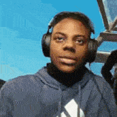
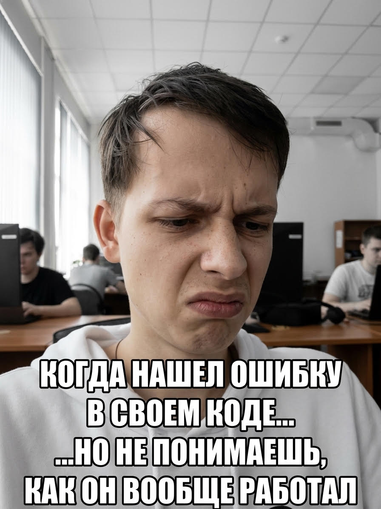

<!DOCTYPE html>
<html lang="en">
<head>

	<title>Мойсайт</title>

</head>
<body style="background-color:rgb(123,123,255)">

<h1>Добро пожаловать</h1>
<h2 style="color:blue">Я Василий</h2>
<h3>Я чемпион Марса по Кавказским шахматам!</h3>

<b>Кстати, голосуйте за меня в конкурсе "Самый быстрый марафонец Кин-Дза-Дза"</b>
  

<b style="padding-top: 50px; padding-left:50px;">
    <i>А еще я люблю картошку</i></b>

 
 

 

</body>

</html>
